# Neat CSV - Spreadsheet Editor

English | [简体中文](MARKETPLACE.zh-CN.md)

Open large CSV/TSV files quickly in VS Code. Select, edit, filter, and sort in a familiar table, or switch to text mode with column colors, alignment, and block editing.

## Work in table mode

Copy, paste, fill, and find/replace (drag to select cells, then right-click).

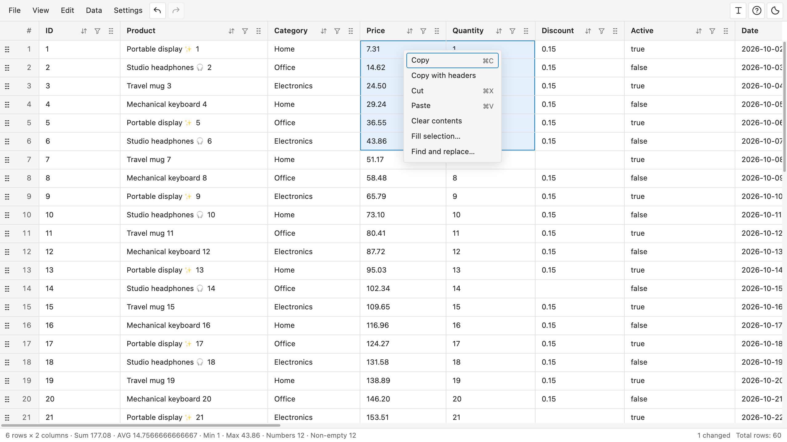

Double-click to edit long or multiline values (Enter applies, Shift+Enter adds a line break, Escape cancels).

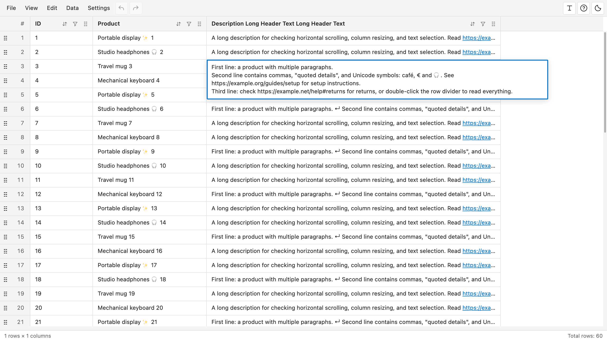

## Work in text mode

Switch modes (top-right **T** opens Text; the table icon returns). Read color-coded columns with optional alignment (**View → Align** or the top-right alignment icon). Fold multiline values onto one line (**View → Fold multiline** or the top-right fold icon; turn off to edit line breaks).

Block editing changes multiple lines together (hold **Option** on Mac or **Alt** on Windows/Linux and drag across lines, then type or delete; **Escape** returns to one cursor).

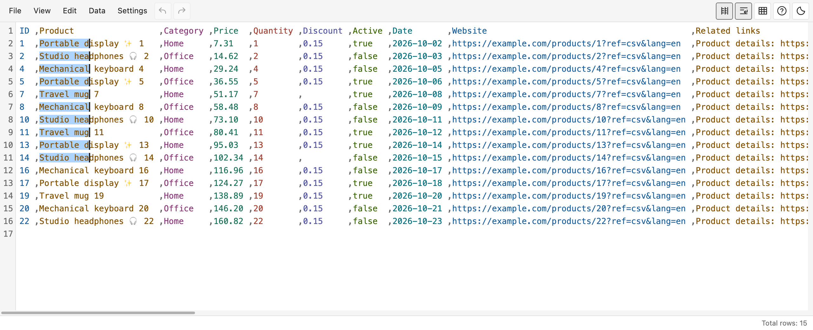

## Select the data you need

Select continuous or disconnected rows, columns, and cells (**Shift-click** extends a range; **Cmd-click** on Mac or **Ctrl-click** on Windows/Linux toggles disconnected selections).

Select rows (click or drag row numbers, using the modifiers above).

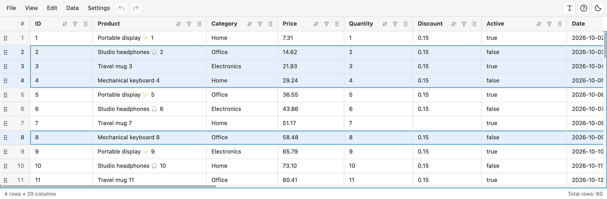

Select columns (click or drag headers; click **#** to select the whole table).

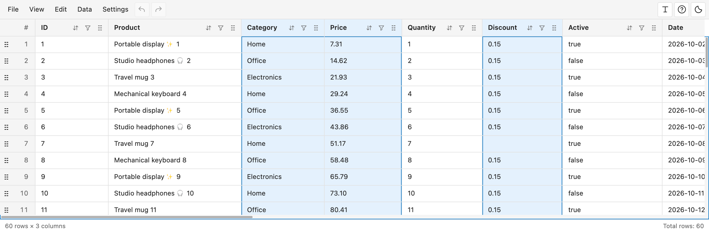

Select disconnected cells (Cmd/Ctrl-click).

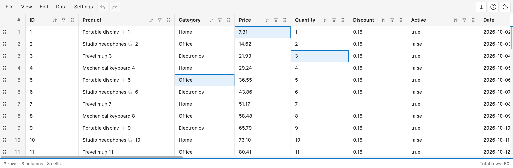

## Filter and sort

Combine filters across columns: text, numbers, value lists, and regex (click a header’s funnel, set conditions, then **Apply**).

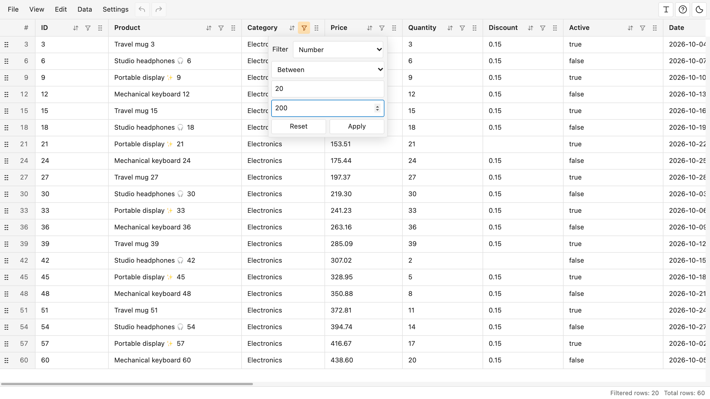

Sort numbers or text (click the sort icon for options; double-click to cycle ascending, descending, and original order).

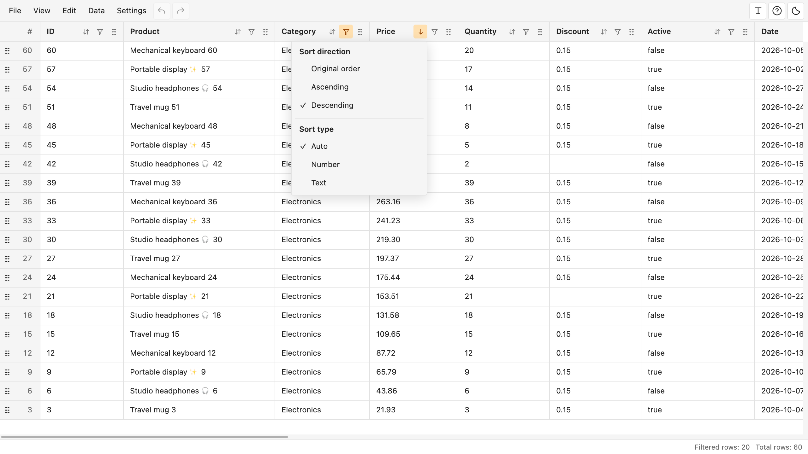

## Work with columns and rows

Keep rows and columns visible while scrolling (double-click drag handles to pin/unpin). Insert or delete them (right-click row numbers or headers), and rename columns (double-click a header outside its buttons).

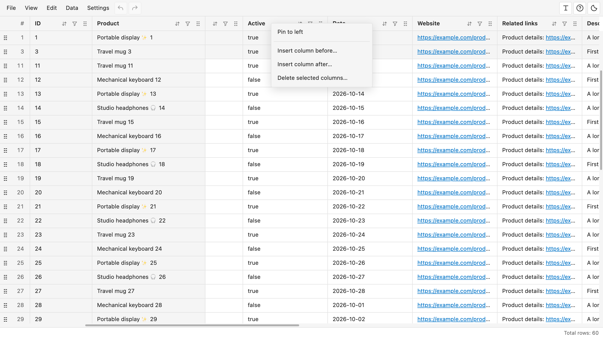

Reorder rows and columns (drag their handles and release at the insertion line).

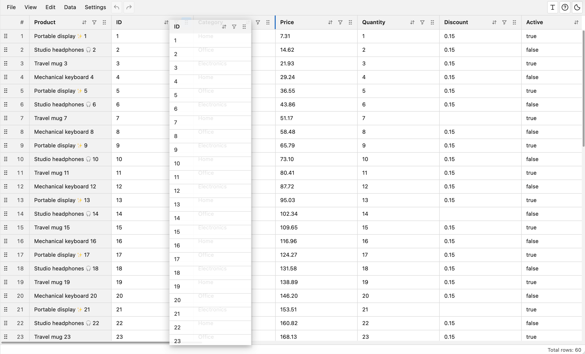

## Selection statistics

See sum, average, minimum, maximum, and counts (select cells and check the bottom bar, or click **Calculate**).

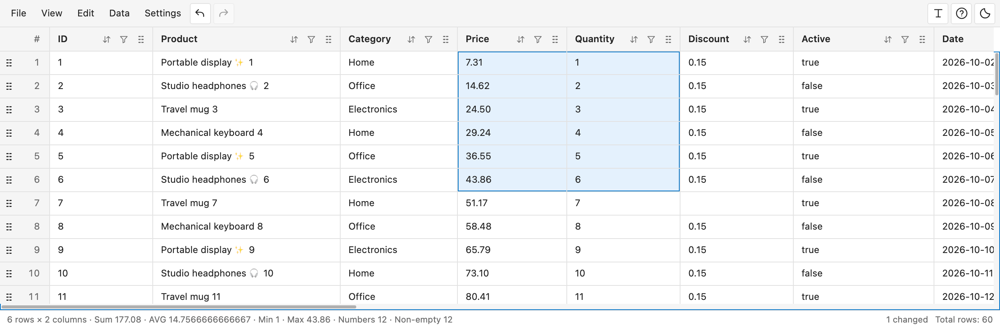

## Check and clean data

Find empty cells, duplicates, and inconsistent column counts (**Data → Check data**, choose a type, then **Run check**). Fill matching cells together (check results or **Select listed results**, then right-click the selection → **Fill selection**).

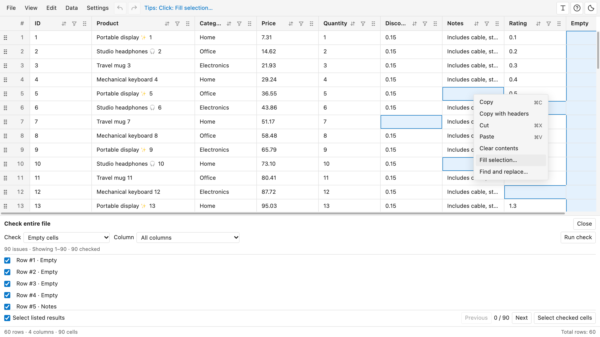

## Open large files fast

Open large files quickly. Progressive loading shows browsable data without waiting for the entire file to load.

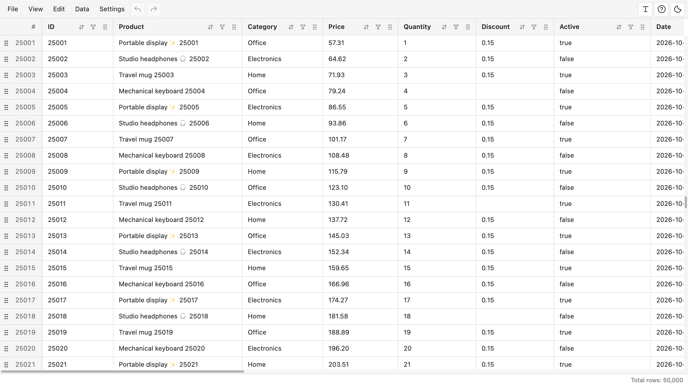

## Save, export, and recover

Edited and inserted cells appear in pale red. Undo/Redo covers cell edits and row/column changes (**Edit → Undo / Redo**, toolbar arrows, or **Cmd+Z / Cmd+Shift+Z** on Mac and **Ctrl+Z / Ctrl+Shift+Z** on Windows/Linux).

**Save** writes edits and manual row/column order (**File → Save** or **Cmd+S / Ctrl+S**). **Save As** creates a copy (**File → Save As**). **Export current view** exports filtered, sorted rows and visible columns (**File → Export current view**, then choose a destination). Pinning affects only the view.

Backups before overwrite keep up to **5 recent versions per file** within the storage budget. Restore older versions, including backups of moved files (**File → Recover** to browse, restore, or clean up; **Settings → Backup settings** for preferences).

## Tips while you work

Hover over cells, headers, or buttons for blue Tips explaining click, double-click, drag, and right-click actions. The tour also introduces Tips (top-right **?** or **View → Quick guide** replays it).

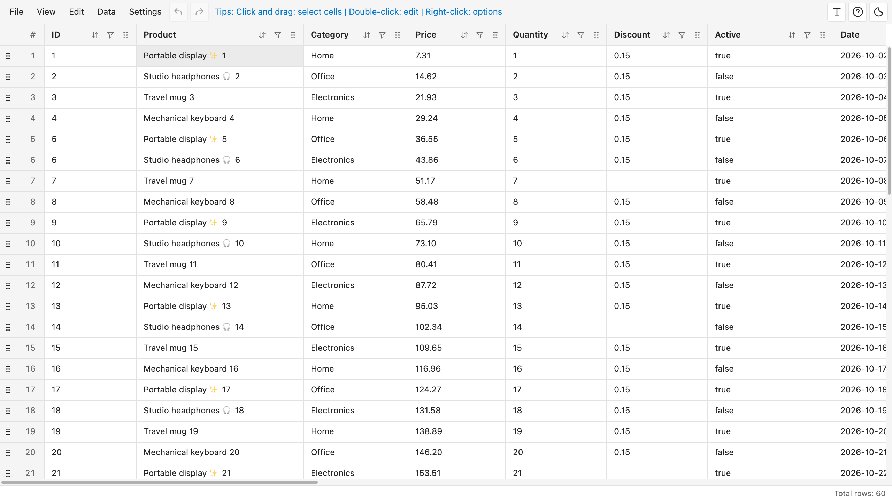

## Dark mode

Switch between light and dark themes (far-right theme icon or **View → Switch color theme**). Your choice is remembered.

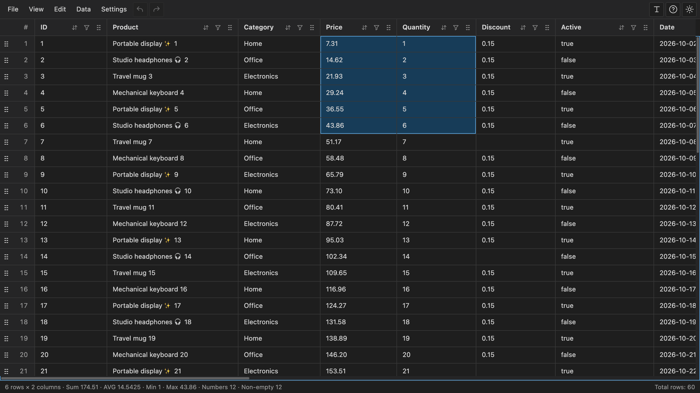

## Also included

- File or selection find/replace (**Edit → Find and replace**, choose a scope).
- Row heights and column widths (drag dividers to resize; double-click to fit).
- Column visibility and row navigation (**View → Show / hide columns** or **Go to row**).
- Links, including URLs within text (click to open in your browser).
- Headerless files, encodings, and custom delimiters (**View → First row as headers**; **Data → File format**).
- English/Simplified Chinese interface (**Settings → Language**).

## Getting started

Install and open a CSV or TSV. If needed, choose **Neat CSV** from **Reopen Editor With**. Requires desktop VS Code 1.95+.
