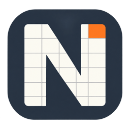

# Neat CSV - Spreadsheet Editor

[English](README.md) | 简体中文

在 VS Code 中快速打开大型 CSV、TSV。在熟悉的表格模式下编辑，也可切换到按列着色、对齐并支持块编辑的文本模式。

## 功能

- 渐进加载大型文件。
- 单元格编辑、连续和不连续多选、复制粘贴及批量填充。
- 列筛选和排序、固定行列、拖动调整顺序及尺寸。
- 文本模式支持列对齐、多行折叠和多光标编辑。
- 选区统计、数据检查、查找替换。
- 撤销重做、另存为、导出视图和版本恢复。
- 明暗主题、中英文界面和操作向导。

查看[功能指南及截图](MARKETPLACE.zh-CN.md)。

## 安装与打开

需要桌面版 VS Code 1.95 或更新版本。从 [Marketplace 安装 Neat CSV](https://marketplace.visualstudio.com/items?itemName=xiaomingio.neat-csv)，然后打开 CSV 或 TSV。必要时使用 **Reopen Editor With → Neat CSV**。也可通过 **Extensions → Install from VSIX…** 安装 VSIX。

## 本地开发

需要 Node.js 22 或更新版本及 npm。

```sh
npm ci
npm run typecheck
npm test
npm run build
npx playwright install chromium --only-shell
npm run test:ui
npm run package
```

`src/extension.ts` 注册编辑器；`src/engine/` 处理文件索引、查询、编辑和保存；`src/webview/` 实现表格和文本模式。跨层消息定义在 `src/protocol.ts`，测试位于 `tests/`。

两份示例位于 `examples/`。截图位于 `docs/images/`，`npm run screenshots` 更新自动截图。构建输出到 `dist/`，VSIX 输出到 `release/`。

## Marketplace 介绍

`npm run package` 使用 `MARKETPLACE.md` 作为插件市场介绍。[中文版介绍](MARKETPLACE.zh-CN.md)覆盖相同功能。

## 许可证

代码采用 [GNU Affero General Public License v3.0](LICENSE)（仅第 3 版，`AGPL-3.0-only`）。

代码许可不授予 Neat CSV 名称或 Logo 的商标权。另行发布自己的产品时，请使用自己的品牌。
